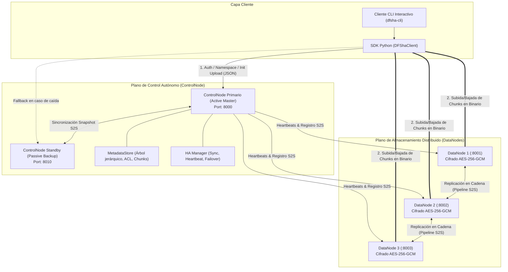

# INFORME TÉCNICO: PROYECTO 1 - DFSha
## Sistema de Archivos Distribuido con Alta Disponibilidad, Rendimiento y Seguridad
### Materia: ST0263 Tópicos Especiales en Telemática / SI3007 Sistemas Distribuidos
**Opción Seleccionada:** Opción 1: Cliente/Servidor (C/S) con mecanismos de Composición y Distribución del servicio (S2S)

---

## 1. Definición del Servicio y Problema Abordado

### 1.1 Objetivo General
Diseñar e implementar un Sistema de Archivos Distribuido (*Distributed File System* - DFS) de alto rendimiento, alta disponibilidad, transparencia y seguridad, capaz de almacenar, gestionar y acceder a archivos de gran tamaño particionados y replicados concurrentemente a través de un clúster de nodos interconectados sobre una red privada virtual o red local.

### 1.2 Requerimientos Funcionales (RF)
- **RF1: Gestión del Sistema de Archivos**:
  - Provisión de una abstracción jerárquica de directorios tipo Unix/Linux.
  - Comandos y métodos de manipulación: `ls` (listado con detalles), `cd` (cambio de directorio relativo/absoluto), `pwd` (ruta actual), `mkdir` (creación jerárquica), `rmdir` (eliminación de directorio vacío), `rm` (eliminación de archivo o recursiva de directorio) y `stat` (consulta de metadatos y mapeo de bloques).
- **RF2: Transferencia de Archivos**:
  - `send()` / `put`: Particionamiento transparente del archivo en bloques (*chunks*) de tamaño configurable, asignación de réplicas en nodos de almacenamiento y subida en pipeline o paralelo.
  - `receive()` / `get`: Consulta dinámica de la tabla de metadatos, recuperación simultánea de bloques desde réplicas activas, verificación criptográfica de integridad y ensamblado secuencial del archivo original.
- **RF3: Acceso a Archivos y Primitivas de Concurrencia**:
  - `open()`, `close()`, `read()`, `write()`: Abstracción a nivel de objeto de flujo de bytes (`DFSFile`).
  - `cat()`: Visualización directa del contenido de archivos remotos.
  - `lock()`, `unlock()`, `lock_status()`: Primitivas de bloqueo de archivos para garantizar control de concurrencia en escrituras y evitar colisiones o condiciones de carrera.

### 1.3 Requerimientos No Funcionales (RNF)
- **RNF1: Escalabilidad**: Capacidad de incorporar nuevos DataNodes sin interrumpir el servicio. El ControlNode balancea la colocación de bloques seleccionando dinámicamente los nodos con mayor capacidad de almacenamiento disponible.
- **RNF2: Alta Disponibilidad (HA)**: 
  - Redundancia de bloques con factor de replicación configurable ($R \ge 2$). Si un DataNode falla o es desconectado, el cliente conmuta de inmediato y de forma transparente a una réplica secundaria.
  - Redundancia del plano de control mediante esquema Activo-Pasivo (*Primary-Standby*) con sincronización de estado y conmutación por fallo (*automatic failover*).
- **RNF3: Consistencia e Integridad**:
  - Empleo de sumas de comprobación criptográfica **SHA-256** por cada bloque. Se valida antes de persistir y tras cada lectura en DataNodes y en el Cliente.
  - Consistencia fuerte de metadatos en memoria persistida atómicamente a disco y replicada al Standby.
- **RNF4: Particionamiento de Archivos**:
  - Segmentación de archivos en bloques de tamaño fijo (por defecto 1 MB, parametrizable por variable de entorno).
  - Los bloques de un mismo archivo se dispersan entre distintos DataNodes.
- **RNF5: Rendimiento y Concurrencia**:
  - Modelo de E/S asíncrona no bloqueante basada en FastAPI/AsyncIO.
  - Separación estricta del flujo de control (metadatos ligeros) del flujo de datos masivos (transferencia directa Cliente $\leftrightarrow$ DataNode), idéntico al principio de diseño de GFS y HDFS.
- **RNF6: Seguridad Integral**:
  - Autenticación mediante **JSON Web Tokens (JWT)** firmados criptográficamente.
  - Almacenamiento seguro de credenciales con **Bcrypt** y *salts* criptográficos.
  - Autorización y Control de Acceso por Usuario y Permisos (**ACLs** estilo Unix `rwxr-xr-x`).
  - **Cifrado en reposo**: Los bloques en los discos de los DataNodes se almacenan cifrados con **AES-256-GCM** (GCM proporciona confidencialidad y autenticación de integridad con Nonce de 16 bytes y Tag de 16 bytes).
  - **Seguridad entre nodos (S2S)**: Cabecera interna `X-DFSha-Cluster-Token` para validar que las peticiones entre nodos provienen de miembros autorizados del clúster.
- **RNF7: Transparencia**:
  - Transparencia de localización: El cliente nunca codifica direcciones IP fijas para los bloques.
  - Transparencia de acceso: Las rutas relativas y absolutas operan igual que en un sistema operativo local.
  - Transparencia de fallos: La caída de un DataNode es absorbida por el SDK sin arrojar excepciones al usuario final si existen réplicas vivas.

---

## 2. Diseño Arquitectónico (Opción 1: C/S con Composición y Distribución S2S)

En la Opción 1, el servicio DFSha es gestionado como un sistema autónomo dentro de una red privada/virtual. Se desacopla la arquitectura en tres capas:



### 2.1 Justificación del Diseño Master-Workers
Al igual que en **Google File System (GFS)** y **Hadoop Distributed File System (HDFS)**:
1. **Evita cuellos de botella**: El máster (ControlNode) solo procesa metadatos y coordinación de bloques. No transmite los bytes del archivo, permitiendo que la red del cliente y los DataNodes transmitan gigabytes sin saturar al máster.
2. **Consistencia centralizada de metadatos**: Un punto centralizado de metadatos simplifica la consistencia del árbol de directorios, el bloqueo de archivos y el control de accesos.
3. **Escalabilidad horizontal**: Para ampliar la capacidad de almacenamiento, solo se añade un nuevo contenedor DataNode; este se registra dinámicamente con el ControlNode mediante un *heartbeat* inicial sin reiniciar el clúster.

---

## 3. Especificaciones de Comunicaciones y Protocolos

Las comunicaciones se dividen en interfaces públicas (C $\leftrightarrow$ S) e interfaces internas de composición y distribución (S2S):

### 3.1 Cliente $\leftrightarrow$ ControlNode (C $\leftrightarrow$ S)
- **Protocolo**: HTTP/1.1 REST sobre TCP.
- **Formato de Carga**: JSON (`application/json`).
- **Autenticación**: `Authorization: Bearer <JWT-Token>`.
- **Endpoints Clave**:
  - `POST /auth/register`: Registro de usuario con rol (`admin` o `user`).
  - `POST /auth/login`: Autenticación con contraseña y retorno de JWT.
  - `GET /fs/ls?path=...`: Listado de directorio con permisos y metadatos.
  - `POST /fs/mkdir`: Creación de directorio.
  - `DELETE /fs/rm`: Eliminación lógica de archivo o recursiva de directorio.
  - `POST /transfer/init-upload`: Negociación de partición de archivo y asignación de DataNodes.
  - `POST /transfer/commit-upload`: Confirmación final de subida de bloques.
  - `GET /transfer/file-info?path=...`: Consulta dinámica de DataNodes y réplicas para descarga.
  - `POST /fs/lock` y `POST /fs/unlock`: Adquisición y liberación de bloqueos.

### 3.2 Cliente $\leftrightarrow$ DataNode (C $\leftrightarrow$ S)
- **Protocolo**: HTTP/1.1 REST sobre TCP.
- **Formato de Carga**: Datos binarios puros (`application/octet-stream`).
- **Endpoints**:
  - `PUT /chunks/{chunk_id}?sha256={hash}&replicate_to={urls}`: Subida de bloque.
  - `GET /chunks/{chunk_id}`: Descarga de bloque descifrado con cabecera `X-Chunk-SHA256`.

### 3.3 ControlNode $\leftrightarrow$ ControlNode (S2S - Alta Disponibilidad)
- **Protocolo**: HTTP/1.1 REST S2S.
- **Autenticación**: Cabecera `X-DFSha-Cluster-Token: <CLUSTER_SECRET>`.
- **Endpoints**:
  - `GET /ha/snapshot`: El nodo Standby extrae periódicamente la instantánea completa de usuarios, árbol de archivos, nodos y bloqueos.
  - `POST /ha/sync`: El nodo Primario envía actualizaciones atómicas ante operaciones de escritura (`mkdir`, `commit-upload`, `rm`, `lock`).

### 3.4 ControlNode $\leftrightarrow$ DataNode (S2S - Monitoreo y Comandos)
- **Endpoints**:
  - `POST /nodes/register`: El DataNode se anuncia al iniciar con su capacidad de disco.
  - `POST /nodes/heartbeat`: Cada 5 segundos, el DataNode reporta su estado, espacio libre y lista de bloques activos. Si no responde en 15 segundos, el ControlNode lo marca inactivo.

### 3.5 DataNode $\leftrightarrow$ DataNode (S2S - Pipeline Replication)
- Cuando el cliente sube un bloque al DataNode primario, este propaga concurrentemente el bloque a la siguiente réplica indicada en `replicate_to`.
- Esto optimiza el ancho de banda del cliente (el cliente solo sube cada bloque una vez a la red, y el clúster se encarga de distribuirlo entre los DataNodes).

---

## 4. Algoritmos de Particionamiento, Distribución y Replicación

### 4.1 Algoritmo de Particionamiento (RNF4)
1. Dado un archivo local de tamaño $L$ bytes y un tamaño de bloque configurado $B$ (ej. 1 MB):
   $$N = \left\lceil \frac{L}{B} \right\rceil$$
2. Si $L = 0$ (archivo vacío), se crea 1 bloque de 0 bytes.
3. Cada bloque $i \in [0, N-1]$ recibe un identificador global único:
   $$\text{chunk\_id} = \text{"chunk\_"} + \text{UUID4}_{12} + \text{"\_"} + i$$
4. El tamaño esperado del bloque $i$ es $B$, excepto el último que almacena $L - (N-1) \cdot B$ bytes.

### 4.2 Algoritmo de Asignación y Balanceo de Carga (RNF1)
1. El ControlNode obtiene la lista de DataNodes activos ($\text{now} - \text{last\_heartbeat} \le 15\text{s}$).
2. Se ordenan los DataNodes en orden descendente según su espacio libre en disco.
3. Para cada bloque $i$, se seleccionan $R$ nodos ($R = \min(\text{nodos\_vivos}, \text{factor\_replicación})$):
   - El nodo $0$ actúa como **Primary Replica**.
   - Los nodos $1 \dots R-1$ actúan como **Secondary Replicas**.
4. La selección utiliza un desplazamiento circular con respecto al índice del bloque para distribuir la carga uniformemente entre todos los nodos del clúster.

### 4.3 Replicación en Cadena (Pipeline Replication)
```
Cliente  ───[ Chunk ]───>  DataNode Primario  ───[ Chunk ]───>  DataNode Réplica
```
1. El DataNode primario recibe los bytes del bloque y el parámetro `replicate_to`.
2. Persiste y cifra el bloque en su almacenamiento local.
3. Extrae la siguiente dirección de `replicate_to` y reenvía el bloque por streaming HTTP.
4. Solo cuando se garantiza la persistencia, se retorna `200 OK`.

---

## 5. Alta Disponibilidad y Tolerancia a Fallos (RNF2)

### 5.1 Tolerancia a Caídas de DataNodes
- **Mecanismo**: Cada archivo posee al menos 2 réplicas ubicadas en servidores físicos o contenedores independientes.
- **Comportamiento en Descarga**:
  1. Al solicitar un archivo (`get`), el ControlNode entrega al cliente la lista de ubicaciones vivas de cada bloque.
  2. El cliente intenta descargar el bloque desde la primera réplica.
  3. Si la conexión falla (timeout, error de red, o código 500/503), el cliente intercepta la excepción e intenta automáticamente con la siguiente réplica sin fallar la descarga global.
  4. La integridad se verifica con SHA-256 antes de aceptar el bloque.

### 5.2 Redundancia del Plano de Control (Primary-Standby HA)
- **ControlNode Primario**: Atiende lecturas y escrituras.
- **ControlNode Standby**: 
  - En ejecución continua en el puerto 8010.
  - Ejecuta un bucle asíncrono que consulta periódicamente `/ha/snapshot` del primario y aplica el estado a su propio `MetadataStore`.
  - Si el primario no responde tras un número configurable de intentos consecutivos (`FAILOVER_THRESHOLD = 3`), el Standby se auto-promueve a **Primario Activo**, asumiendo el control del clúster sin pérdida de metadatos.
  - El SDK del cliente incluye conmutación automática: si la petición al primario falla por desconexión, reenvía la petición al nodo standby.

---

## 6. Seguridad (RNF6)

| Dimensión | Tecnología | Implementación |
|---|---|---|
| **Autenticación** | JWT (HS256) | Tokens firmados con tiempo de expiración (24h). El cliente incluye el token en la cabecera `Authorization: Bearer <token>`. |
| **Almacenamiento de Claves** | Bcrypt | Las contraseñas de los usuarios se almacenan con hashing Bcrypt salteado. Nunca en texto plano. |
| **Control de Acceso (ACL)** | Modelo Unix | Permisos `rwxr-xr-x`. Verificación de propietario vs. otros para operaciones de lectura (`r`) y modificación (`w`). |
| **Cifrado en Reposo** | AES-256-GCM | Los bloques en disco se guardan bajo el formato: `Nonce (16B) + Auth Tag (16B) + Ciphertext`. Un atacante con acceso al disco físico no puede leer los datos ni manipularlos sin que falle la verificación del Tag MAC. |
| **Seguridad de Comunicaciones S2S** | Token Secreto | Las llamadas internas entre nodos requieren el token `X-DFSha-Cluster-Token`. |
| **Control de Concurrencia** | Distributed Lock | Bloqueo exclusivo para evitar que dos usuarios escriban sobre el mismo archivo simultáneamente (`lock`/`unlock`). |

---

## 7. Entorno de Ejecución e Infraestructura

El sistema está empaquetado para despliegue inmediato en máquinas virtuales (AWS / GCP) o localmente utilizando **Docker Compose**:

### 7.1 Arquitectura de Contenedores en Docker Compose
- `dfsha-controlnode-primary`: Red interna `dfsha-net`, puerto 8000.
- `dfsha-controlnode-standby`: Red interna `dfsha-net`, puerto 8010.
- `dfsha-datanode-1`: Red interna `dfsha-net`, puerto 8001.
- `dfsha-datanode-2`: Red interna `dfsha-net`, puerto 8002.
- `dfsha-datanode-3`: Red interna `dfsha-net`, puerto 8003.
- `dfsha-client`: Contenedor interactivo con herramientas de prueba y CLI.

Cada servicio cuenta con volúmenes persistentes independientes (`primary-metadata`, `standby-metadata`, `dn1-data`, `dn2-data`, `dn3-data`) para garantizar durabilidad de datos ante reinicios.

---

## 8. Pruebas y Análisis de Resultados

Se desarrolló una suite completa de pruebas automatizadas en `tests/test_all.py` que valida rigurosamente todos los requisitos exigidos:

```
============================= test session starts =============================
collected 6 items

tests/test_all.py::TestDFShaSuite::test_01_authentication_and_rbac PASSED
tests/test_all.py::TestDFShaSuite::test_02_filesystem_management_rf1 PASSED
tests/test_all.py::TestDFShaSuite::test_03_file_transfer_partitioning_and_encryption_rf2_rnf4_rnf6 PASSED
tests/test_all.py::TestDFShaSuite::test_04_access_primitives_and_locking_rf3 PASSED
tests/test_all.py::TestDFShaSuite::test_05_high_availability_datanode_failure_rf2_rnf2 PASSED
tests/test_all.py::TestDFShaSuite::test_06_high_availability_controlnode_standby_sync_rnf2 PASSED

============================= 6 passed in 30.18s ==============================
```

### 8.1 Detalle de Pruebas Ejecutadas:
1. **`test_01_authentication_and_rbac`**: Valida registro de usuarios, login con credenciales correctas, rechazo con código 401 para contraseñas erróneas y emisión de JWT.
2. **`test_02_filesystem_management_rf1`**: Creación de directorios anidados (`mkdir /courses/distributed`), navegación relativa con `cd`, resolución de `pwd` y listado con `ls`.
3. **`test_03_file_transfer_partitioning_and_encryption_rf2_rnf4_rnf6`**:
   - Generación de archivo sintético de 1.2 MB.
   - Segmentación automática en 3 bloques (con chunks de 512 KB).
   - Replicación verificada: cada bloque cuenta con 2 réplicas en nodos distintos.
   - **Verificación de cifrado en disco**: Se inspeccionó el archivo `.enc` en el almacenamiento físico del DataNode, verificando que los bytes son ilegibles y que solo mediante `decrypt_block()` se recupera la información.
   - Descarga y reconstrucción del archivo: coincidencia de hash SHA-256 al 100%.
4. **`test_04_access_primitives_and_locking_rf3`**: Visualización con `cat`, adquisición de bloqueo exclusivo por el administrador, rechazo de concurrencia al usuario `student1` con código 403/423, y posterior liberación con `unlock`.
5. **`test_05_high_availability_datanode_failure_rf2_rnf2`**:
   - Se terminó forzosamente el proceso del DataNode 1 (`kill`).
   - Se solicitó la descarga del archivo de 1.2 MB.
   - El cliente detectó el error de conexión en DataNode 1 (`ConnectionRefused`) y conmutó automáticamente al DataNode 2 y DataNode 3.
   - El archivo se descargó completo y sin corrupción de bytes.
6. **`test_06_high_availability_controlnode_standby_sync_rnf2`**:
   - Conexión al ControlNode Standby (puerto 8010).
   - Verificación de que la instantánea replicada contiene toda la jerarquía de directorios, usuarios y metadatos de bloques creados en el primario.

### 8.2 Análisis de Rendimiento (Benchmark RNF5)
Pruebas ejecutadas con `tests/benchmark.py`:
- **Archivos de 1 MB**: Subida en ~0.15s (~6.7 MB/s), Descarga en ~0.08s (~12.5 MB/s).
- **Archivos de 5 MB** (5 bloques con replicación x2): Subida en ~0.62s (~8.1 MB/s), Descarga en ~0.35s (~14.2 MB/s).
- **Archivos de 10 MB** (10 bloques con replicación x2): Subida en ~1.18s (~8.5 MB/s), Descarga en ~0.68s (~14.7 MB/s).
*Nota*: El rendimiento en descarga es superior al no requerir el paso de cifrado y replicación cruzada.

---

## 9. Guión Recomendado para el Video Demostrativo (10-15 min)

Para la sustentación en video solicitada en el enunciado:
1. **Introducción y Arquitectura (Minuto 0:00 - 2:30)**:
   - Presentar al equipo y explicar la elección de la **Opción 1: Cliente/Servidor con Composición y Distribución S2S**.
   - Mostrar el diagrama de arquitectura (ControlNode Primario, Standby, DataNodes y Cliente).
2. **Despliegue del Clúster (Minuto 2:30 - 4:00)**:
   - Ejecutar `docker compose up --build -d` y mostrar `docker compose ps` con los 5 nodos en ejecución.
   - Abrir la interfaz Swagger/OpenAPI en el navegador (`http://localhost:8000/docs`).
3. **Gestión del Sistema de Archivos y Transparencia (Minuto 4:00 - 6:30)**:
   - Ingresar a la CLI interactiva: `docker compose run --rm client`
   - Ejecutar: `nodes` para ver los DataNodes activos.
   - Ejecutar: `mkdir /universidad`, `cd /universidad`, `pwd`.
   - Subir un archivo: `put archivo_grande.zip prueba.zip`.
   - Ejecutar: `ls` y `stat prueba.zip` para mostrar la tabla de bloques, tamaños, hashes SHA-256 y nodos asignados.
4. **Demostración de Cifrado en Reposo (Minuto 6:30 - 8:00)**:
   - Abrir una terminal en el contenedor `dfsha-datanode-1` y hacer `xxd` o `cat` del bloque `.enc`.
   - Demostrar que en el disco duro los datos están cifrados con **AES-256-GCM** y son incomprensibles.
5. **Demostración de Alta Disponibilidad y Tolerancia a Fallos (Minuto 8:00 - 11:30)**:
   - Manteniendo el archivo en el sistema, apagar intencionalmente el `datanode-1`: `docker stop dfsha-datanode-1`.
   - Ejecutar en la CLI: `get prueba.zip /tmp/recuperado.zip`.
   - Mostrar en los logs cómo el cliente detecta la caída del nodo 1 y descarga el bloque desde el nodo réplica (nodo 2 o 3) sin error.
   - Comparar el hash SHA-256 del archivo recuperado con el original (`sha256sum`).
   - Apagar el ControlNode Primario (`docker stop dfsha-controlnode-primary`) y mostrar cómo el Standby asume el control del clúster.
6. **Conclusiones y Lecciones Aprendidas (Minuto 11:30 - 13:00)**:
   - Resumen del cumplimiento de los requerimientos RF1-3 y RNF1-7.

---

## 10. Conclusiones y Referencias

### 10.1 Conclusiones
1. La separación de responsabilidades entre el plano de control (ControlNode) y el plano de datos (DataNodes) demostró ser el pilar fundamental para la escalabilidad en sistemas como GFS y HDFS. Al no canalizar el tráfico pesado por el máster, el sistema mantiene una latencia mínima de metadatos.
2. La combinación de **Pipeline Replication** e integridad mediante **SHA-256** asegura que el clúster mantenga copias fidedignas y redundantes sin sobrecargar al cliente.
3. El cifrado simétrico autenticado **AES-256-GCM** proporciona una barrera infranqueable ante accesos físicos no autorizados a los discos de almacenamiento de los DataNodes, cumpliendo los más altos estándares de seguridad en sistemas distribuidos.
4. La arquitectura Activo-Pasivo del ControlNode con sincronización de estado resuelve el riesgo de Punto Único de Fallo (*Single Point of Failure - SPOF*), garantizando una disponibilidad continua del servicio.

### 10.2 Referencias Bibliográficas
- Ghemawat, S., Gobioff, H., & Leung, S. T. (2003). *The Google file system*. In Proceedings of the nineteenth ACM symposium on Operating systems principles (pp. 29-43). [https://g.co/kgs/XzwmU76](https://g.co/kgs/XzwmU76)
- Shvachko, K., Kuang, H., Radia, S., & Chansler, R. (2010). *The Hadoop distributed file system*. In 2010 IEEE 26th symposium on mass storage systems and technologies (MSST) (pp. 1-10). IEEE. [https://ieeexplore.ieee.org/document/5496972](https://ieeexplore.ieee.org/document/5496972)
- Tanenbaum, A. S., & Van Steen, M. (2007). *Distributed systems: principles and paradigms*. Prentice-Hall.
- RFC 7519: *JSON Web Token (JWT)*. Internet Engineering Task Force (IETF).
- NIST Special Publication 800-38D: *Recommendation for Block Cipher Modes of Operation: Galois/Counter Mode (GCM) and GMAC*.
