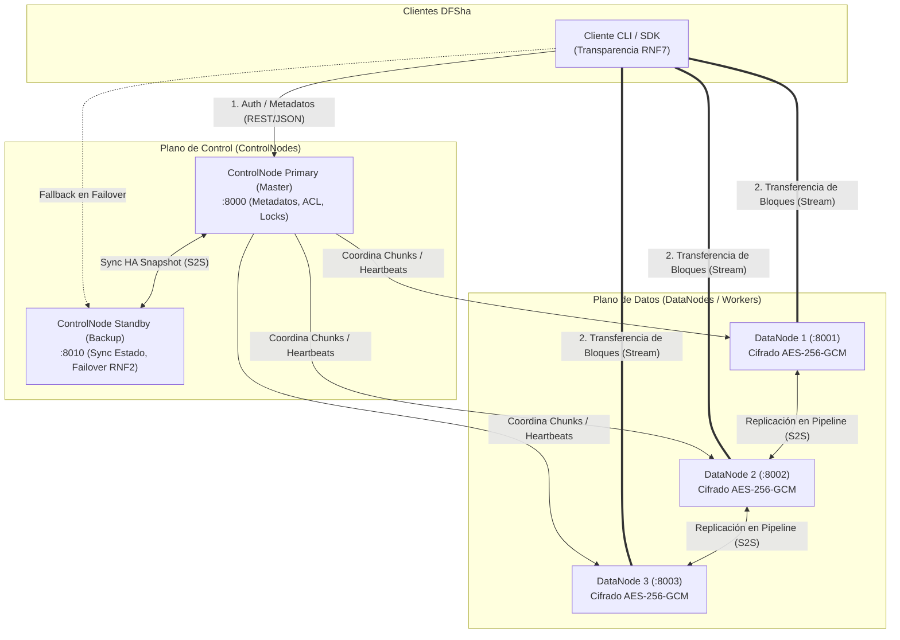

# DFSha: Sistema de Archivos Distribuido con Alta Disponibilidad, Rendimiento y Seguridad

[]()
[]()
[]()
[]()

**DFSha** (*Distributed File System - High Availability*) es una implementación completa, robusta y modular de un sistema de archivos distribuido basado en bloques (inspirado en la arquitectura de **Google File System (GFS)** y **Hadoop Distributed File System (HDFS)**), desarrollado bajo la **Opción 1 (Arquitectura Cliente/Servidor con Composición y Distribución Servicio a Servicio - S2S)**.

---

## 🏛️ Arquitectura del Sistema (Opción 1)

El sistema implementa una arquitectura **Maestro-Trabajadores (Master-Workers)** autónoma con redundancia en el nodo maestro y replicación en los nodos de datos:



### Componentes Principales:
1. **ControlNode (Master / NameNode)**:
   - Administra el árbol jerárquico de directorios y archivos.
   - Mapea archivos a bloques particionados (*chunks* con IDs únicos y hashes SHA-256).
   - Control de acceso por usuarios (RBAC) y listas de control de acceso (ACL).
   - Primitivas de concurrencia y bloqueo distribuido exclusivo/compartido (`lock`/`unlock`).
   - Monitoreo de salud mediante *heartbeats* periódicos de DataNodes.
   - **Alta Disponibilidad (RNF2)**: Réplica *Standby* que sincroniza instantáneas del estado y asume como primario en caso de caída del máster.
2. **DataNodes (Workers / ChunkServers)**:
   - Almacenan físicamente los bloques en disco.
   - **Seguridad en reposo (RNF6)**: Cifrado simétrico autenticado **AES-256-GCM**. Los archivos en disco físico están cifrados y son ilegibles sin la clave del clúster.
   - **Integridad (RNF3)**: Verificación criptográfica obligatoria con **SHA-256** en cada lectura y escritura.
   - **Replicación en Pipeline (S2S - RNF2 y RNF5)**: El cliente envía un bloque al DataNode primario, y este lo replica directamente al siguiente nodo en la cadena de replicación.
3. **Cliente DFSha (CLI & SDK Python)**:
   - Shell interactivo estilo terminal Linux (`ls`, `cd`, `mkdir`, `rm`, `pwd`).
   - Transferencia eficiente de archivos grandes mediante particionamiento en bloques (`put` / `send`, `get` / `receive`).
   - **Transparencia total (RNF7)**: El usuario navega rutas jerárquicas sin conocer la ubicación física de las máquinas ni los bloques. Si un DataNode falla, el cliente conmuta automáticamente a otra réplica disponible de forma transparente.

---

## 📋 Mapeo de Requerimientos

| Requisito | Descripción | Implementación en DFSha |
|---|---|---|
| **RF1** | Gestión del sistema de archivos | Comandos `ls`, `cd`, `pwd`, `mkdir`, `rmdir`, `rm`, `stat`. Soporte jerárquico tipo Unix con permisos. |
| **RF2** | Transferencia de archivos | Operaciones `put` / `send()` y `get` / `receive()`. Partición en chunks y reconstrucción íntegra. |
| **RF3** | Acceso a archivos y primitivas | `cat()`, abstracción `open()`, `read()`, `write()`, `close()`, concurrencia con `lock()` y `unlock()`. |
| **RNF1** | Escalabilidad | Balanceo de carga en la asignación de bloques entre DataNodes por capacidad disponible. |
| **RNF2** | Alta Disponibilidad | Factor de replicación $R \ge 2$, failover automático en lectura ante caída de un DataNode, y máster secundario Activo-Pasivo. |
| **RNF3** | Consistencia de Datos | Checksums **SHA-256** por bloque, metadatos atómicos persistidos y sincronizados con WAL/Snapshot. |
| **RNF4** | Particionamiento de Archivos | Archivos segmentados en bloques de tamaño configurable (por defecto 1 MB), distribuidos en nodos distintos. |
| **RNF5** | Rendimiento y Concurrencia | E/S asíncrona no bloqueante (FastAPI + AsyncIO), replicación en pipeline DataNode $\to$ DataNode. |
| **RNF6** | Seguridad | Autenticación con **JWT** y contraseñas hasheadas con **Bcrypt**, ACLs de usuario/grupo, cifrado en reposo **AES-256-GCM** y secreto de clúster S2S (`X-DFSha-Cluster-Token`). |
| **RNF7** | Transparencia | Descubrimiento dinámico de réplicas en tiempo de ejecución. El cliente nunca referencia IPs estáticas para los bloques. |

---

## 🚀 Despliegue Rápido con Docker Compose

La forma recomendada de desplegar el clúster completo (1 ControlNode Primario, 1 ControlNode Standby, 3 DataNodes y 1 Contenedor Cliente) es mediante Docker Compose:

```bash
# 1. Clonar el repositorio y ubicarse en la raíz
cd D:\DFSha

# 2. Levantar el clúster distribuido en segundo plano
docker compose up --build -d

# 3. Verificar estado de los contenedores
docker compose ps
```

### Puertos Expuestos:
- **ControlNode Primario**: `http://localhost:8000` (Docs OpenAPI: `http://localhost:8000/docs`)
- **ControlNode Standby**: `http://localhost:8010` (Docs OpenAPI: `http://localhost:8010/docs`)
- **DataNode 1**: `http://localhost:8001`
- **DataNode 2**: `http://localhost:8002`
- **DataNode 3**: `http://localhost:8003`

### Iniciar la CLI interactiva del Cliente en Docker:
```bash
docker compose run --rm client
```

---

## 💻 Ejecución Nativa en Local (Python)

Si deseas ejecutar o depurar el sistema directamente en Python (sin Docker):

```bash
# 1. Crear entorno virtual e instalar dependencias
python -m venv .venv
.\.venv\Scripts\activate   # En Linux: source .venv/bin/activate
pip install -r requirements.txt

# 2. Ejecutar la suite completa de pruebas automáticas
pytest tests/test_all.py -v -s
```

La suite de pruebas levanta automáticamente un clúster aislado en memoria y disco, comprueba los 6 escenarios (autenticación, jerarquía, particionamiento, cifrado AES, caída de nodo y sincronización HA) y limpia los recursos al finalizar.

---

## 🛠️ Guía de Uso del CLI Interactivo

Al iniciar `python -m client.cli` o mediante Docker, se presenta una shell interactiva con autologin como `admin`:

```text
admin@dfsha:/$ help

File System Operations (RF1):
  ls [path]                 List files and directories
  cd <path>                 Change working directory
  pwd                       Print working directory
  mkdir <path>              Create directory
  rmdir <path>              Remove empty directory
  rm [-r] <path>            Delete file or directory (recursive with -r)

Transfer Operations (RF2):
  put <local> [remote]       Upload file, partition in chunks, distribute to DataNodes (alias: send)
  get <remote> [local]       Download file, reassemble chunks with replica failover (alias: recv)

Access & Concurrency Primitives (RF3):
  cat <remote_file>          View file content
  stat <remote_file>         View detailed metadata & chunk mapping
  lock <remote_file>         Acquire exclusive lock on file
  unlock <remote_file>       Release file lock

Cluster & Security (RNF2 & RNF6):
  login <user> <pass>       Authenticate and receive JWT token
  register <user> <pass>    Create new user account
  whoami                    Display logged in user info
  nodes                     List cluster DataNodes and health status
  cluster                   Show ControlNode primary/standby health status
```

### Ejemplos Prácticos de Comandos:

```bash
# Crear directorios
admin@dfsha:/$ mkdir /documentos
admin@dfsha:/$ cd /documentos

# Subir un archivo grande (se divide en chunks cifrados y se replica)
admin@dfsha:/documentos$ put C:\Users\usuario\archivo.pdf tesis.pdf

# Listar el contenido con formato enriquecido
admin@dfsha:/documentos$ ls

# Inspeccionar metadatos y distribución de bloques
admin@dfsha:/documentos$ stat tesis.pdf

# Bloquear el archivo para edición exclusiva (RF3)
admin@dfsha:/documentos$ lock tesis.pdf

# Descargar el archivo reconstruido
admin@dfsha:/documentos$ get tesis.pdf C:\Users\usuario\descarga.pdf

# Liberar el bloqueo
admin@dfsha:/documentos$ unlock tesis.pdf

# Ver nodos activos del clúster
admin@dfsha:/documentos$ nodes
```

---

## 🧪 Demostración de Tolerancia a Fallos (Alta Disponibilidad)

Para verificar en vivo que el sistema tolera la caída de nodos sin interrumpir las operaciones ni perder datos:

1. Subir un archivo al sistema (`put test.dat /test.dat`).
2. Detener un DataNode:
   ```bash
   docker stop dfsha-datanode-1
   ```
3. Descargar el archivo inmediatamente:
   ```bash
   docker compose run --rm client python -m client.cli get /test.dat /tmp/recuperado.dat
   ```
4. El cliente detectará que el DataNode primario no responde, consultará la réplica en el DataNode 2 o 3, verificará el hash SHA-256 y entregará el archivo íntegro sin errores.
5. Reactivar el nodo:
   ```bash
   docker start dfsha-datanode-1
   ```

---

## 📊 Especificación de Endpoints REST (APIs)

### ControlNode (Metadatos & Coordinación)
- `POST /auth/register`: Registro de nuevos usuarios.
- `POST /auth/login`: Autenticación y expedición de tokens JWT.
- `GET /fs/ls?path=...`: Listado jerárquico de directorios.
- `POST /fs/mkdir`: Creación de directorio.
- `POST /fs/rmdir`: Eliminación de directorio vacío.
- `DELETE /fs/rm`: Eliminación de archivo o directorio recursivo.
- `GET /fs/stat?path=...`: Información detallada de archivo y lista de chunks.
- `POST /transfer/init-upload`: Planificación y asignación de DataNodes para los bloques.
- `POST /transfer/commit-upload`: Confirmación y registro de subida exitosa.
- `GET /transfer/file-info?path=...`: Consulta dinámica de réplicas para descarga.
- `POST /fs/lock`: Adquisición de bloqueo concurrente.
- `POST /fs/unlock`: Liberación de bloqueo.
- `GET /ha/snapshot`: Instantánea de estado para réplica Standby (S2S).
- `POST /ha/sync`: Aplicación de sincronización de estado (S2S).

### DataNode (Almacenamiento de Chunks)
- `GET /health`: Estado de salud, capacidad libre y número de bloques.
- `GET /chunks`: Lista de chunks almacenados localmente.
- `PUT /chunks/{chunk_id}`: Recepción de chunk en crudo, cifrado AES-256-GCM y replicación en pipeline hacia el siguiente DataNode.
- `GET /chunks/{chunk_id}`: Lectura de chunk descifrado con cabecera `X-Chunk-SHA256`.
- `DELETE /chunks/{chunk_id}`: Eliminación física de bloque.
- `POST /internal/replicate`: Directiva S2S para replicación dirigida por el máster.

---

## 👥 Autores
- Proyecto 1: Sistemas Distribuidos / Tópicos Especiales en Telemática (SI3007 / ST0263).
- Implementación de la **Opción 1: Cliente/Servidor con Composición y Distribución S2S**.
